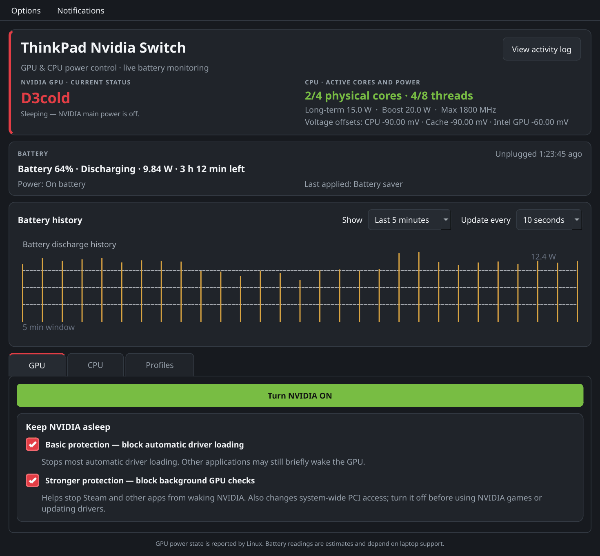
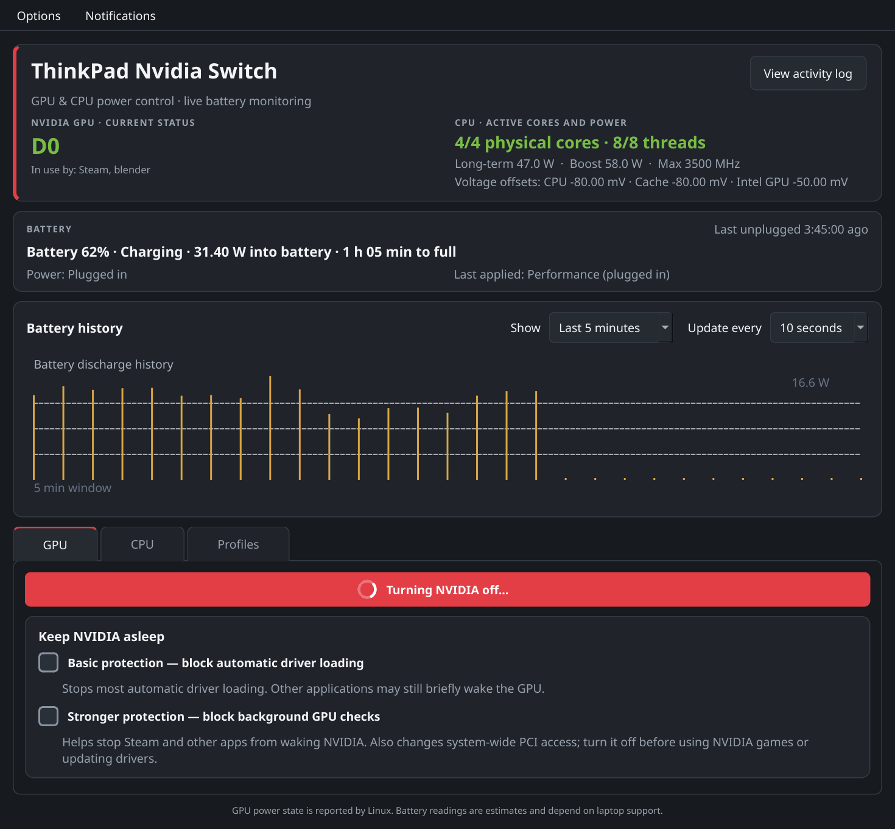
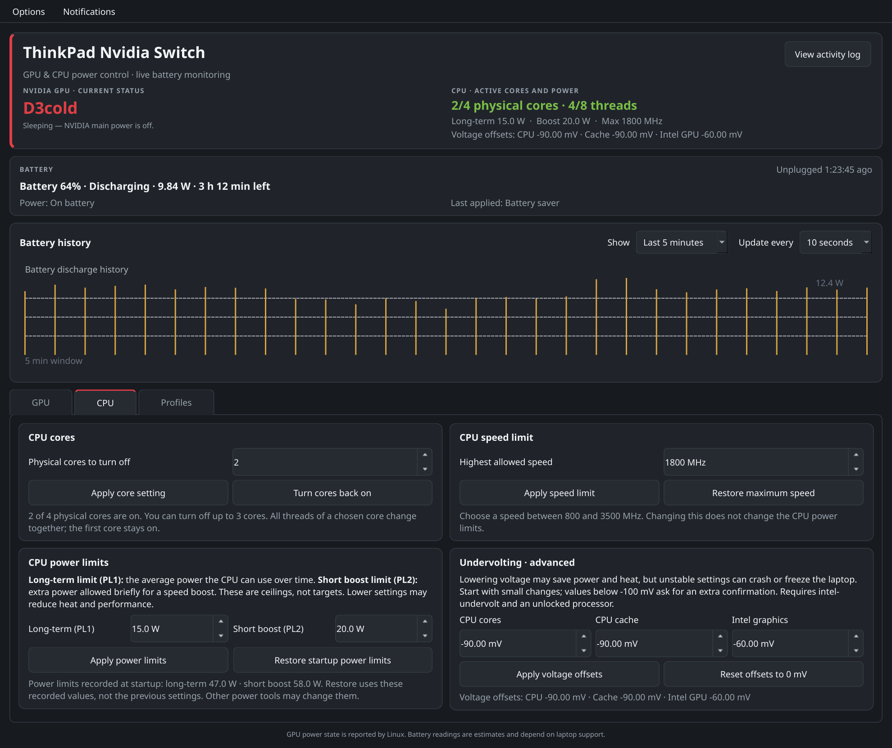
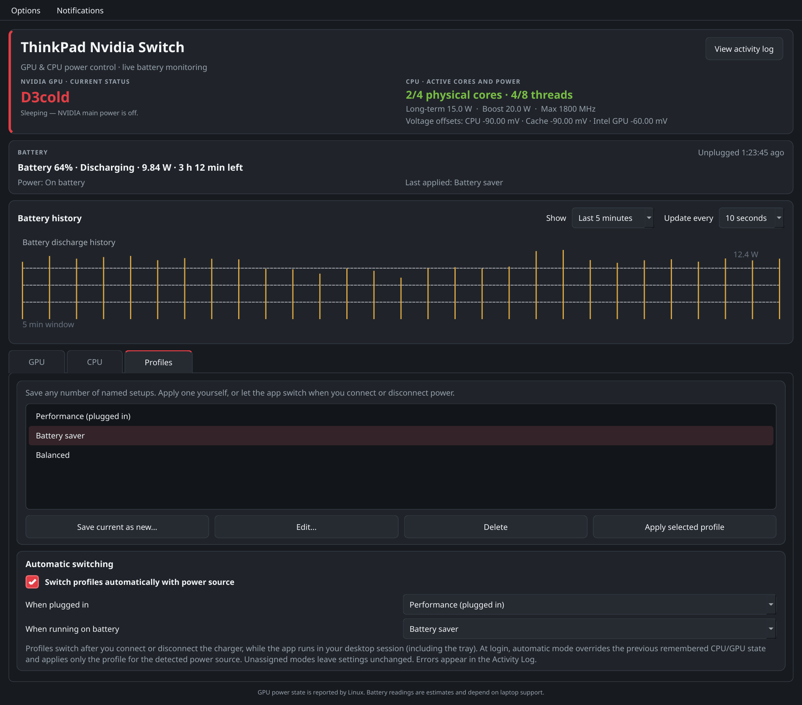
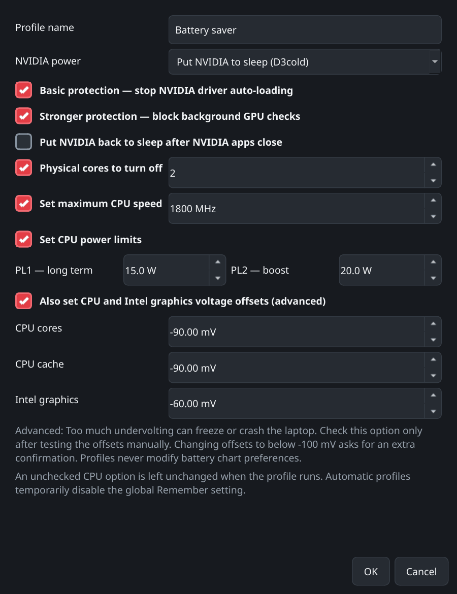
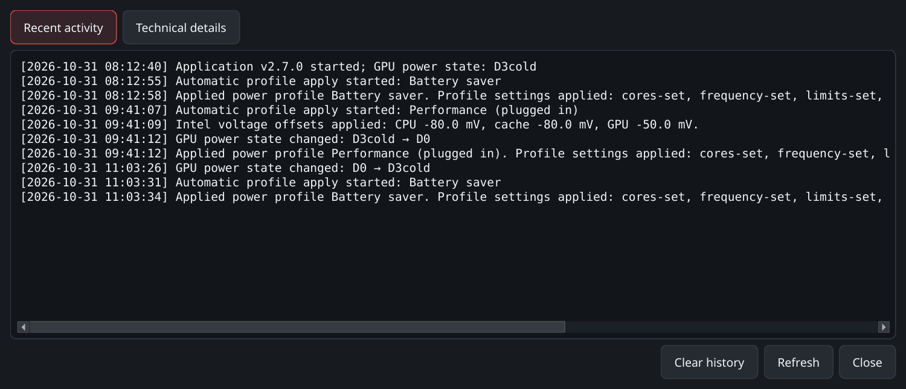

# ThinkPad Nvidia Switch

**Version 2.7.0** · **MIT licensed** · **Linux / KDE Plasma (tested target)**

A tray application for Linux laptops with hybrid graphics. It can put a supported NVIDIA discrete GPU to sleep, limit CPU activity, show battery charge/discharge rates and estimated remaining time, manage Intel CPU/GPU voltage offsets, and save named power profiles. Profiles can be applied by hand or selected automatically when the charger is connected or disconnected.

It was developed on a **Lenovo ThinkPad T440p** (Intel Core i7-4710MQ, NVIDIA GeForce GT 730M, legacy NVIDIA 470 driver) and is also used on a **Lenovo Y520** (Intel Core i5-7300HQ, GeForce GTX 1060 Mobile), both running CachyOS with KDE Plasma on Wayland. See [Tested hardware](#tested-hardware).



<sub>The screenshots in this README are rendered from the real interface code with **simulated readings**; they are not captures from a laptop.</sub>

<details>
<summary>More screenshots</summary>

**The ON/OFF button while a switch is running** (spinner until Linux reports the new power state)



**CPU tab:** cores, speed limit, power limits and voltage offsets



**Profiles tab:** named profiles and automatic switching with the power source



**Profile editor** and **activity log**





</details>

> **Compatibility.** This is a hardware-specific utility, not a universal laptop power manager. It detects a single NVIDIA display controller, but it has **not** been validated on every Optimus laptop, desktop environment, driver or kernel. CPU power limits need **Intel RAPL**; undervolting needs the separate `intel-undervolt` tool. Each feature is switched off, not guessed, when the hardware does not offer it.
>
> **Safety.** The installer adds a *passwordless* sudo rule for fixed, validated helper programs, and the "Stronger protection" option changes system-wide PCI and driver-loader state. Read [Safety, recovery and security](#safety-recovery-and-security) and [SECURITY.md](SECURITY.md) before installing. PCI `remove`/`rescan` is **never** used.

## Contents

- [Requirements](#requirements)
- [Install, upgrade and uninstall](#install-upgrade-and-uninstall): [Install](#install) · [Upgrade](#upgrade) · [Uninstall](#uninstall)
- [Using the app](#using-the-app)
  - [Main window](#main-window) · [GPU tab](#gpu-tab) · [CPU tab](#cpu-tab) · [Profiles tab](#profiles-tab) · [Menus and tray](#menus-and-tray-icon) · [What happens at login](#what-happens-at-login)
- [Safety, recovery and security](#safety-recovery-and-security)
- [KDE Wayland: keeping the desktop on Intel](#kde-wayland-keeping-the-desktop-on-intel)
- [Files and locations](#files-and-locations)
- [Troubleshooting](#troubleshooting)
- [Tested hardware](#tested-hardware)
- [Development](#development)
- [Scope and project status](#scope-and-project-status)

## Requirements

**Required**

| Needed for | Requirement |
|---|---|
| Everything | Linux with `/sys` PCI and power-supply interfaces, a desktop session with a **system tray**, `systemd` |
| The application | **Python 3.9 or newer** and **PySide6** (Qt 6) for the `python3` you run the installer with |
| The root helpers | `/usr/bin/python3` (3.9 or newer), `sudo` (including `visudo`), `modprobe` (kmod), `mount`/`umount` (util-linux) |
| GPU control | One NVIDIA PCI display controller supported by the installed **proprietary** NVIDIA kernel driver. The project ships no driver: install the branch that supports your GPU and that builds for your kernel (see [Troubleshooting](#troubleshooting) if the module is missing after a kernel update) |

**Optional.** A feature whose requirement is missing is switched off and nothing else is affected.

| Feature | Requirement |
|---|---|
| **Voltage offsets** (CPU tab) | The **[`intel-undervolt`](https://github.com/kitsunyan/intel-undervolt) package**, a separate program the app drives (it is **not** installed by this app), and a processor and firmware that permit voltage changes. The package provides the root-owned `/etc/intel-undervolt.conf` the app edits |
| CPU power limits | Intel RAPL `package-0` with long-term and short-term constraints in `/sys/class/powercap` |
| CPU cores / speed | CPU hotplug (`online` files) and `cpufreq` policies in sysfs |
| KDE workaround | KWin 6.7.4 or newer on Wayland, one Intel graphics device, Mesa's EGL vendor file |

KDE Plasma on Arch/CachyOS is the tested target; other desktops and distributions are not validated. On Arch/CachyOS:

```bash
# required
sudo pacman -S --needed pyside6 sudo kmod util-linux

# optional: the voltage-offset card on the CPU tab
sudo pacman -S --needed intel-undervolt
```

Without `intel-undervolt` the app works normally; the voltage card then says "the intel-undervolt package is not installed" and its buttons stay greyed out until the package is found (the check repeats every 15 seconds). If your distribution does not package it, build it from its [project page](https://github.com/kitsunyan/intel-undervolt). The installer prints a note when the package is missing.

Other distributions: install PySide6 from your distribution if it packages it, otherwise from PyPI (`python3 -m pip install PySide6`, inside a virtual environment if your distribution requires one; run `install.sh` with that environment active, and the launcher will remember that interpreter).

The app never installs or removes system packages. To remove the app itself, see [Uninstall](#uninstall).

## Install, upgrade and uninstall

### Install

1. Install the [requirements](#requirements) first (at least the *Required* packages; `intel-undervolt` if you want voltage offsets).
2. **Quit the running application** from its tray menu (the installer refuses to replace a running copy).
3. Download or clone the project, open a terminal in its root directory, and run **as your normal desktop user** (not with `sudo`; the script refuses to run as root):

   ```bash
   ./install.sh
   ```

4. Authorize with your administrator password once. Start **ThinkPad Nvidia Switch** from the application menu. From then on normal operations (GPU, CPU, voltage, profiles) never ask for a password. If the sudo rule is missing, `sudo -n` fails and the app reports an error instead of prompting.
5. Reboot once if **Restore startup power limits** says no startup PL1/PL2 snapshot exists. Snapshots are taken early in boot, never from whatever values are active when the installer runs.

The installer detects exactly one NVIDIA display controller and refuses to guess when there are none or several. An old v2.2 installation that left the GPU detached from PCI needs a reboot first.

**Installer options** (environment variables):

| Variable | Effect |
|---|---|
| `TPNS_KWIN_INTEL_ONLY=0` | Do not install the KWin "Intel only" drop-in (render node and display device; use this if a display is wired to NVIDIA) |
| `TPNS_KWIN_VULKAN_FIX=0` | Do not install the `KWIN_DISABLE_VULKAN=1` Plasma session file |

**What the installer changes** (review `install.sh` first; several items are system-wide):

- User files: the application under `~/.local/share/thinkpad-nvidia-switch/`, a launcher and an icon in the standard desktop/icon directories.
- Root-owned helpers in `/usr/local/libexec/`: `thinkpad-nvidia-switch-helper` (GPU), `-cpu-helper`, `-profile-apply`, `-undervolt`, the wrappers `-restore` and `-auto-off`, and the modules they import (`cpu_power.py`, `profiles.py`, `undervolt_control.py`).
- `/etc/thinkpad-nvidia-switch/gpu-pci-address`: the detected GPU. The helpers refuse any other address.
- `/var/lib/thinkpad-nvidia-switch/`: reversible recovery records (directory `0755`, files `0600`).
- `/etc/sudoers.d/thinkpad-nvidia-switch-restore`: a **passwordless** rule for your user that names *only* the six installed programs above. It is validated with `visudo` before activation. Any process running as your user can invoke those programs without authentication; see [SECURITY.md](SECURITY.md).
- A systemd service, `thinkpad-nvidia-switch-cpu-boot-defaults.service`, that records the early-boot Intel PL1/PL2 values.
- On KDE (KWin present): `~/.config/plasma-workspace/env/thinkpad-nvidia-switch-kwin-nvidia-fix.sh` (`KWIN_DISABLE_VULKAN=1`, affects your session after the next login) and, when detection succeeds, the [KWin Intel-only drop-in](#kde-wayland-keeping-the-desktop-on-intel).

At the end the installer runs a harmless request through the sudo rule to confirm that it works without a password, and warns if it does not.

### Upgrade

Quit the app from its tray menu, unpack the new release and run `./install.sh` again. Upgrades keep preferences, profiles, logs, the GPU identity and any active guard / recovery state. After upgrading from a release older than 2.6.9 on KDE Wayland, log out and back in so the updated KWin drop-in takes effect.

### Uninstall

1. **Quit the app** from its tray menu.
2. Run, as the same user (not with `sudo`):

   ```bash
   ./uninstall.sh
   ```

   from the project folder, or `~/.local/share/thinkpad-nvidia-switch/uninstall.sh` if you no longer have it.
3. **Log out and back in** so KDE drops the session workarounds.

The uninstaller first restores everything the app changed, **before** it removes the helpers and recovery records: NVIDIA guard permissions, the PCI config mount and driver binding, app-managed CPU cores, CPU speed and power limits, and the `intel-undervolt` configuration (only if it still exactly matches the last change this app made; a file you or another program edited since is left alone). If any restoration fails it stops and keeps the records, so you can fix the cause and run it again.

It then removes the root helpers and the sudoers rule, the boot-defaults service, `/var/lib/thinkpad-nvidia-switch/` and `/etc/thinkpad-nvidia-switch/`, the app-managed KWin drop-in and session file, and your user files: the application folder, launcher, autostart entry, icon, **saved profiles and settings**, and logs. Back up `~/.config/thinkpad-nvidia-switch/profiles.json` first if you want to keep your profiles. Your own KWin overrides (for example `50-mesa-only.conf`) are never touched.

**Packages are not removed.** The app never installed PySide6, `intel-undervolt` or the NVIDIA driver, so the uninstaller leaves them. Remove them yourself if you no longer need them, **after** running the uninstaller (it needs `intel-undervolt` to put your voltage configuration back):

```bash
sudo pacman -Rns intel-undervolt    # -n also deletes /etc/intel-undervolt.conf
```

The CPU forgets voltage offsets at the next reboot unless a service reapplies them. This app never enables an `intel-undervolt` service; if you enabled one yourself, disable it (`sudo systemctl disable --now intel-undervolt`) before removing the package.

## Using the app

### Main window

The dashboard at the top is visible on every tab:

- **NVIDIA GPU:** `D3cold` means Linux reports the GPU asleep; `D0` means awake. These are PCI power states, *not electrical measurements*. When awake it names an application that currently has NVIDIA device files open ("In use by …"), or says the GPU is on without an identified user. An open device is evidence of current use, **not proof** of what woke the GPU.
- **CPU:** active/total physical cores and threads, long-term and boost power limits, the maximum CPU speed, and the live CPU / CPU cache / Intel GPU voltage offsets.
- **Battery:** charge, status and rate; remaining time while discharging, or power *into the battery* and time to full while charging. Estimates come from `/sys/class/power_supply` (`power_now` and `energy_*` preferred; `current_now` × `voltage_now` and `charge_*` as fallback; the sign of the rate is ignored because drivers differ). They are indicative, never guaranteed; the app shows "unavailable" rather than inventing a number.
- **Power source** (Plugged in / On battery / Not detected) and the last applied profile.
- **Time since unplugged** (top right of the battery card): how long ago the charger was last unplugged, counting up every second (for example *Unplugged 1:23:45 ago*; after plugging in again it reads *Last unplugged … ago* and keeps counting). Linux does not record when the power source changed, so the time starts when this app *sees* the change (it checks every two seconds). If the app started while the laptop was already on battery, or was not running for a while, it says *at least*, because the real unplugging may have been earlier. The time is remembered in `unplug-timer.json`, so restarting the app (for example after an upgrade) does not reset it, but a reboot does. A charger change while the laptop is asleep is not seen.
- **Battery history:** a chart of discharge watts (it records 0 W while the battery is not discharging, and a gap when no reading is available). **Show** (1, 5, 10, 15 or 30 minutes) and **Update every** (2 to 60 seconds) are global settings, not part of any profile.

The window scrolls vertically when it is short, and each tab is exactly as tall as its own content. With enough width the CPU and Profiles cards sit in two columns. Closing the window only hides it; use **Quit** in the tray menu to exit. While the window is hidden only the work that nobody can see is paused: the battery, CPU and voltage read-outs (and the 15-second voltage poll) are not updated, and they are refreshed the moment the window is shown. GPU state tracking, notifications, the tray menu, battery-history sampling and automatic profiles keep running. An idle window uses well under 1 % of one CPU core. Only one copy runs per desktop user: starting it again raises the existing window. `--minimized` (used by autostart) starts hidden in the tray.

### GPU tab

- **Turn NVIDIA ON / OFF:** loads the proprietary modules (`nvidia`, `nvidia_uvm`, `nvidia_modeset`, `nvidia_drm`) after removing both protections, or unloads them, enables PCI runtime power management and waits up to 8 seconds for `D3cold`. The switch runs in the background: the button shows a spinner and "Turning NVIDIA off…" (or "on…") from the click until Linux reports the new power state, so the window never looks frozen. Meanwhile the protections, the tray toggle and profile buttons are paused and an automatic profile waits. Turning off fails while a program, or the desktop session itself, still uses NVIDIA, and modules are never force-unloaded. A failure is explained in plain words, naming what uses the GPU, for example *NVIDIA cannot be turned off because it is in use by Steam and blender. Close them, then try again.* A desktop component such as `kwin_wayland` is described as such (it is not something you can close; see [KDE Wayland](#kde-wayland-keeping-the-desktop-on-intel)). The message appears in a dialog, or as a tray notification when the window is hidden; the technical text stays in the activity log.
- **Basic protection:** writes a modprobe rule (`/etc/modprobe.d/optimus-tray-block.conf`) that stops automatic loading of the NVIDIA modules. It does not stop every PCI probe or wake-up. Enabling it unloads the modules and puts the GPU to sleep.
- **Stronger protection:** everything Basic does (through its own rule file, `optimus-tray-probe-guard.conf`), plus:
  - removes the execute bits of `nvidia-modprobe`;
  - sets the permissions of NVIDIA's Vulkan / EGL / OpenCL loader manifests to `0000`, so loaders such as Steam's capability scan cannot load NVIDIA libraries just to enumerate the sleeping GPU;
  - sets the GPU's PCI `driver_override` to `none`;
  - bind-mounts `/dev/null` over the GPU's sysfs `config` file, hiding it from ordinary userspace PCI-config reads (this is a mount in the host namespace: other namespaces may still see it, and it is not a security boundary).

  Then it unloads the modules and puts the GPU to sleep. Original modes and values are recorded *before* any change. **Turn it off before NVIDIA games, driver updates or PCI diagnostics.**

Basic and Stronger are independent switches. **Turn NVIDIA ON** removes both. Neither can promise that nothing will wake the GPU.

### CPU tab

Privileged CPU settings go through the root helper and need no password once installed.

| Control | What it does | Notes |
|---|---|---|
| **CPU cores** | Turn off whole *physical* cores (all their threads) | The core holding CPU0 always stays on; it takes the highest-numbered cores. Only cores this app turned off are ever turned back on. Disabled while other tools have CPUs offline |
| **CPU speed limit** | Cap `scaling_max_freq` for the *online* cores, in MHz (100 MHz steps) | Offline policies are skipped and re-capped when the app brings those cores back; if the kernel refuses to re-apply the old cap after a core change, the cores still change and the activity log shows a warning. **Restore maximum speed** sets the hardware maximum, not your previous cap |
| **PL1 / PL2** | Intel RAPL package long-term (5-55 W) and short boost (5-70 W) limits | Ceilings, not targets. PL2 must be at least PL1. Writes are read back and rolled back if firmware rejects them |
| **Restore startup power limits** | Returns to the PL1/PL2 recorded early in *this* boot | Disabled until a verified record from the current boot exists |
| **Undervolting** | CPU cores, CPU cache and Intel GPU offsets | See below |

Lower limits can reduce heat and speed but do not always extend battery life: a slower task can run longer. Compare under the **same workload** before drawing conclusions.

#### Undervolting (advanced, optional)

Offsets are in millivolts from **0** down to **−200** with two decimals. A negative value asks the CPU for less voltage; it does not guarantee a saving or stability. Too large an offset can freeze the laptop instantly. **Save your work, start small and stress-test every setting.** The −200 mV floor is a safety limit in the app, not a hardware limit, and **offsets below −100 mV ask for an extra, explicit confirmation** (the answer defaults to *No*): when you click *Apply voltage offsets*, and again when you save such offsets in a profile, because profiles can be applied automatically at login and on every charger change. Offsets already stored in a profile, or read from the live hardware when you save the current state, are not asked about again unless you change them. If your existing `intel-undervolt` configuration uses offsets below −200 mV, the fields stop at −200 mV and applying from this app would change them.

The app uses the existing `intel-undervolt` program (`/usr/bin/intel-undervolt` or `/usr/local/bin/intel-undervolt`), never its own MSR writes. The root helper changes only voltage domains 0 (CPU), 1 (GPU) and 2 (CPU Cache) in `/etc/intel-undervolt.conf` (which must be a regular, root-owned file that is not group/world-writable), keeps other domains and lines, applies the change, reads the offsets back and **restores the old configuration if the CPU does not report them**. It refuses to work if the file has active `power` or `tjoffset` directives, which could override the RAPL limits managed here. Applying asks for confirmation; **Reset offsets to 0 mV** sets all three to zero (it is not a BIOS reset).

Current offsets are read in the background at startup, every 15 seconds **while the window is open** (not while it is hidden in the tray; they are read as soon as it is shown), after a profile is applied and when the CPU tab opens; unapplied values you are editing are not overwritten. The app does not install or enable an `intel-undervolt` service, so an existing service may reapply offsets at boot or resume. Modern microcode may lock this feature; the app then reports that the hardware refused. The first pre-app configuration is kept in `/var/lib/thinkpad-nvidia-switch/undervolt-original.json`; on uninstall it is restored only if the file still matches the last change this app made.

### Profiles tab

A profile is a named setup (any number; names are unique, case-insensitive, up to 120 characters). **Save current as new…** reads the live state into the editor; creating or editing a profile changes nothing on the machine.

| Setting | Behavior when the profile is applied |
|---|---|
| NVIDIA power | Leave unchanged, put to sleep (`D3cold`), or wake (`D0`). `D0` cannot be combined with a protection |
| Basic / Stronger protection | Disabled when not ticked. Enabling a protection also unloads NVIDIA and puts the GPU to sleep, so with *Put to sleep* it is enabled as chosen, and with *Leave unchanged* it is enabled only if the GPU is already asleep. While the GPU is on, a protection that is already on stays on and one that is not on is **not** switched on (the log says so), so the GPU is never switched off behind your back |
| Auto-sleep | Sets the *Put NVIDIA back to sleep after NVIDIA apps close* option |
| Physical cores to turn off, CPU speed, PL1/PL2 | Each is optional; an unchecked setting is left alone, which suits CPUs without RAPL or hotplug |
| Voltage offsets | Optional and off by default; all three are set together |

Applying runs in this order: CPU cores, CPU speed, power limits, voltage offsets, then the GPU (a wake removes both protections first, then loads the driver; otherwise sleep first, then the chosen protections). A profile is **not atomic**: every independent group (cores, speed, power limits, voltage, NVIDIA) is attempted even if an earlier one failed, so a single hiccup cannot leave the rest of a battery profile unapplied. A failed CPU step is retried once after 1.5 seconds. A speed limit that the kernel still refuses is tried twice more *after* the other steps (3 and 5 seconds later), and when a speed limit is refused the technical log records a `SPEED LIMIT DIAGNOSTICS` snapshot (cpufreq driver, governor, per-policy limits, intel_pstate settings and any known power tools that are running). The report names every step that failed and everything that was applied. Inside the NVIDIA group the steps depend on each other, so it stops at its first failure. CPU settings run first so a busy NVIDIA driver cannot block them. Never force-unload a busy driver. To see what holds NVIDIA:

When turning NVIDIA off fails because the driver is busy, the message ends with `NVIDIA is held open by: <program> (PID …)`. The helper looks for programs that have `/dev/nvidia*` **or NVIDIA's display nodes** (`/dev/dri/cardN`, `/dev/dri/renderDN` of the NVIDIA GPU) open, so a compositor such as KWin or Xwayland shows up by name. You can check by hand:

```bash
ls -l /dev/dri/by-path                       # which cardN / renderDN is NVIDIA's (its PCI address)
sudo fuser -v /dev/nvidia* /dev/dri/* 2>&1
lsmod | grep '^nvidia'
```

If no program is named, a kernel component may still hold `nvidia_drm`. The technical log then contains `NVIDIA MODULE …` lines with each module's reference count, the modules using it and the `modeset` / `fbdev` parameters. See the [KDE section](#kde-wayland-keeping-the-desktop-on-intel); you may need to end the desktop session. The full helper output is in **View activity log**; pop-ups show a short explanation.

**Apply automatically.** Assign a profile to **When plugged in** and another to **When running on battery** (either may be *Do nothing*) and enable **Switch profiles automatically with power source**. The app reads `/sys/class/power_supply` every 2 seconds (any online `Mains`/`USB*` supply means AC), requires two consistent readings, and switches only when the source or the assigned profile changes. It does this **while the app is running**, including hidden in the tray; enable *Start at login* for use after boot. The first automatic switch happens about 15 seconds after the app starts. If an automatic apply fails you get a tray warning with the reason (also in the tooltip of the *Power profile* line and in the activity log) and it is retried **once** after 10 seconds, but never in a loop; after that, fix the cause and apply manually, or change power source. Applying a profile by hand marks the current assignment as handled so it is not immediately overridden. Profiles are not a pre-login boot service.

Profile storage: `~/.config/thinkpad-nvidia-switch/profiles.json` (owner-only, written atomically, schema v2; older v1 files are migrated without losing names, assignments or settings). Back it up before downgrading to a release older than v2.6.3. A corrupt file is never overwritten with an empty list; the app suspends automatic switching until you repair it.

### Menus and tray icon

**Options**

- **Start at login, minimized to tray:** writes `~/.config/autostart/thinkpad-nvidia-switch.desktop`.
- **Remember and restore GPU + CPU settings when the app starts:** saves the GPU state and protections plus the CPU core count, speed cap and PL1/PL2 (each CPU domain is remembered separately) and re-applies them about 15 seconds after the app starts. It is unavailable while automatic profiles are on; your previous choice returns when they are turned off.
- **Put NVIDIA back to sleep after NVIDIA apps close:** after the GPU wakes (`D3cold` → `D0`) the app tracks the application session that uses NVIDIA (its systemd app scope, or the process tree) and, once that session has ended and no process holds an NVIDIA device for 2 seconds, returns the GPU to sleep. It is inactive while a protection is on, waits 20 seconds after you turn the GPU on yourself, and stops waiting if no user appears within 15 seconds. Results depend on the driver and hardware.

**Notifications** (each switch is saved): *NVIDIA GPU wakes up or goes to sleep* (on by default), *Charger connected or disconnected*, *Automatic power profile applied*, *Saved CPU/GPU settings restored at startup* (off by default). There is no charger notification for the first reading after login.

**View activity log** opens a modeless window with *Recent activity* and *Technical details*. The logs are `~/.local/state/thinkpad-nvidia-switch/operations.log` (about 5,000 lines) and `detailed.log` (about 20,000 lines), owner-only. The technical log can contain file names, process names, PIDs and command output: **redact it before sharing.**

**Tray menu:** current GPU state, *Toggle NVIDIA ON / OFF*, the two protections, *Power profiles…*, *View activity log*, *Open ThinkPad Nvidia Switch*, *Quit*. The icon shows `ON`, `OFF` or `?`.

### What happens at login

When **automatic profiles are enabled** the old *Remember and restore* routine does **not** run. The app waits for the AC/battery reading and applies only the profile assigned to that source, so shutting down on battery and booting on AC applies the AC profile directly. If the source is unknown or has no profile assigned, nothing is applied and there is **no fallback** to the last-used settings. A corrupt profiles file also blocks both. When automatic profiles are off, *Remember and restore* works as described above. Firmware and the OS set their own CPU/GPU state before the desktop app starts; the app does not replace that.

## Safety, recovery and security

- **Stronger protection is system-wide.** It can make PCI tools report missing GPU data and can interfere with drivers, games and other power tools. Do not delete `/var/lib/thinkpad-nvidia-switch/` while a protection is active: it holds the original permissions and PCI override.
- **If NVIDIA will not wake:** close GPU programs, turn Stronger protection off, then use *Turn NVIDIA ON*. Do not use PCI remove/rescan. Reboot clears volatile PCI power state and mounts, but file-permission changes persist until restored, so keep recovery records if a restore fails.
- **Passwordless helpers.** The GUI runs unprivileged and calls fixed programs with `sudo -n`. The helpers validate the GPU address against the root-owned config, bound every number, accept no paths or shell commands, and pin `PATH` so nothing in the caller's environment is executed as root. The rule is a deliberate trade-off: any process running as your user can use it. Do not install it on shared or untrusted accounts without reviewing [SECURITY.md](SECURITY.md).
- **Partial failures** (hotplug, RAPL, cpufreq, voltage) are rolled back where possible, and recovery records are written *before* the first change.

### CPU boot-default notes

Linux has no universal factory PL1/PL2. This app's early-boot service records what the platform configured near the start of the **current boot**; another service that runs earlier may already have changed it. Without a valid record the restore button stays disabled. To inspect:

```bash
cat /run/thinkpad-nvidia-switch-cpu-boot-defaults.json          # public, same-boot copy
sudo cat /var/lib/thinkpad-nvidia-switch/cpu-firmware-boot-limits.json   # private original
systemctl status thinkpad-nvidia-switch-cpu-boot-defaults.service
```

## KDE Wayland: keeping the desktop on Intel

By default KWin opens **every** GPU on the seat. If KWin (and, through it, `systemd-logind`, `systemd`, Xwayland and every application that follows KWin's GPU) keeps NVIDIA's devices open, `modprobe: FATAL: Module nvidia_drm is in use` appears when a profile tries to power NVIDIA off, even with no game running. Two different KWin settings are involved:

| KWin variable | What it limits | Why it matters |
|---|---|---|
| `KWIN_RENDER_NODES` | The *render* nodes (`/dev/dri/renderDN`) KWin opens for drawing (KWin 6.7.4 or newer) | Keeps KWin's rendering off NVIDIA's render node |
| `KWIN_DRM_DEVICES` | The *display* devices (`/dev/dri/cardN`) KWin opens | A driver that registers a display device for NVIDIA (`nvidia-drm` with `modeset=Y`, the default on current drivers) makes KWin open it as a GPU. Without this setting NVIDIA stays in use even when only the render node is restricted |

When the installer finds a compatible `kwin_wayland`, **exactly one** Intel graphics device with working PCI `/dev/dri/by-path/` links for both its render node and its display device (both must belong to the same device), and Mesa's EGL vendor file, it installs a user-level systemd drop-in, `~/.config/systemd/user/plasma-kwin_wayland.service.d/90-thinkpad-nvidia-switch-intel-render.conf`, that sets for **KWin only**:

- `KWIN_RENDER_NODES=` an app-owned, colon-free symlink, `~/.config/thinkpad-nvidia-switch/kwin-intel-render`, that points to Intel's stable PCI by-path render link;
- `KWIN_DRM_DEVICES=` an app-owned, colon-free symlink, `~/.config/thinkpad-nvidia-switch/kwin-intel-card`, that points to Intel's stable PCI by-path card link (so renumbered `cardN` / `renderD*` nodes do not matter; both variables treat `:` as a list separator, so the raw by-path names cannot be used);
- `__EGL_VENDOR_LIBRARY_FILENAMES=/usr/share/glvnd/egl_vendor.d/50_mesa.json`.

If detection is inconclusive nothing is changed. Steam's and other applications' environments are not modified. **Monitors wired directly to the NVIDIA GPU do not work in the KDE session while this is installed** (KWin no longer opens that GPU), and neither can NVIDIA be switched off while it drives a display, so skip it with `TPNS_KWIN_INTEL_ONLY=0 ./install.sh` if you need those ports, or remove an existing one with `python3 src/kwin_render_setup.py uninstall`. You must **log out and back in** for it to take effect. **If you installed an earlier release, run `./install.sh` again:** releases before 2.6.9 only set `KWIN_RENDER_NODES`, and the installer upgrades the drop-in in place. If KDE then fails to start, switch to a text console (Ctrl+Alt+F3), delete only that `90-…` file, run `systemctl --user daemon-reload` and reboot. Your own overrides (for example `50-mesa-only.conf`, `70-intel-render.conf`) are never touched, and the `90-` file takes precedence over them.

To check after a new login:

```bash
pid=$(pgrep -n -x kwin_wayland)
sudo cat /proc/$pid/environ | tr '\0' '\n' | grep -E 'KWIN_RENDER_NODES|KWIN_DRM_DEVICES|EGL_VENDOR'
ls -l ~/.config/thinkpad-nvidia-switch/kwin-intel-render ~/.config/thinkpad-nvidia-switch/kwin-intel-card
ls -l /dev/dri/by-path                      # which cardN / renderDN is NVIDIA's
sudo fuser -v /dev/dri/* /dev/nvidia* 2>&1
```

KWin should hold Intel's devices only; NVIDIA's `cardN` and `renderDN` should be free (a browser that decodes video on NVIDIA, for example, can still hold the render node until it is closed). The separate `KWIN_DISABLE_VULKAN=1` session file limits NVIDIA probing by KWin's Vulkan backend on the tested legacy driver.

## Files and locations

| Path | Purpose |
|---|---|
| `~/.local/share/thinkpad-nvidia-switch/` | Installed application (and `uninstall.sh`) |
| `~/.config/thinkpad-nvidia-switch/settings.json` | UI preferences (tab, history, notifications, options) |
| `~/.config/thinkpad-nvidia-switch/profiles.json` | Named profiles and AC/battery assignments |
| `~/.config/thinkpad-nvidia-switch/unplug-timer.json` | When the charger was last seen unplugged (for the battery card timer) |
| `~/.local/state/thinkpad-nvidia-switch/` | `operations.log`, `detailed.log` |
| `~/.config/autostart/thinkpad-nvidia-switch.desktop` | Created by *Start at login* |
| `~/.config/systemd/user/plasma-kwin_wayland.service.d/90-thinkpad-nvidia-switch-intel-render.conf` and the symlinks `~/.config/thinkpad-nvidia-switch/kwin-intel-render`, `kwin-intel-card` | The [KWin Intel-only drop-in](#kde-wayland-keeping-the-desktop-on-intel) (KDE Wayland only) |
| `~/.config/plasma-workspace/env/thinkpad-nvidia-switch-kwin-nvidia-fix.sh` | KDE session file (`KWIN_DISABLE_VULKAN=1`) |
| `/etc/systemd/system/thinkpad-nvidia-switch-cpu-boot-defaults.service` | Early-boot capture of the CPU power limits |
| `/usr/local/libexec/thinkpad-nvidia-switch-*`, `cpu_power.py`, `profiles.py`, `undervolt_control.py` | Root-owned helpers and their modules |
| `/etc/thinkpad-nvidia-switch/gpu-pci-address` | The detected GPU |
| `/etc/sudoers.d/thinkpad-nvidia-switch-restore` | The passwordless rule |
| `/etc/modprobe.d/optimus-tray-block.conf`, `optimus-tray-probe-guard.conf` | Present while Basic / Stronger protection is on |
| `/var/lib/thinkpad-nvidia-switch/` | Recovery records and saved state (files `0600`) |
| `/run/thinkpad-nvidia-switch-cpu-*.json` | Public, same-boot status for the GUI |

## Troubleshooting

| Symptom | Check |
|---|---|
| GPU shows `GPU device not found` or `Unknown` | `cat /etc/thinkpad-nvidia-switch/gpu-pci-address` and `/sys/bus/pci/devices/<address>/power_state`. A device left detached by v2.2 needs a reboot |
| `Reboot required (v2.2 PCI detach)` | Reboot once; current releases never remove PCI devices |
| Controls report a sudo or password error | Check `/etc/sudoers.d/thinkpad-nvidia-switch-restore`. This must print `Invalid CPU helper action…` without asking for a password: `sudo -k; sudo -n /usr/local/libexec/thinkpad-nvidia-switch-cpu-helper selftest`. Re-run `./install.sh` if not |
| GPU briefly reports `D0` | Applications can probe PCI config or activate the driver. `D0` alone does not mean sustained use; see the technical log |
| Stronger protection is on but PCI tools still see data | Mount namespaces vary and not every access path is covered. It is not a kernel-level boundary |
| Turning NVIDIA off says it is *in use by …* | The message names what holds the GPU: close those programs and try again. If it names the desktop (`kwin_wayland`, `Xwayland`) see the [KDE section](#kde-wayland-keeping-the-desktop-on-intel). If it names nothing, open *Technical details* and read the `NVIDIA HOLDER` and `NVIDIA MODULE` lines, or run `ls -l /dev/dri/by-path`, `sudo fuser -v /dev/nvidia* /dev/dri/*` and `lsmod \| grep '^nvidia'`. The raw `modprobe: FATAL: Module … is in use` line in the log is the same event |
| Turning NVIDIA off logs `modprobe: FATAL: Module i915 is in use` (or names another non-NVIDIA module) but the GPU did go to sleep | `modprobe -r` also removes unused dependencies and handles the *soft dependencies* configured in `modprobe.d`, so it can complain about another module after every NVIDIA module has already been removed. The app judges the result by whether any NVIDIA module is still loaded and treats an unload that worked as done; the complaint stays in the technical log, together with `MODPROBE PLAN` lines showing what `modprobe -r` intends to remove. To see the configured soft dependencies: `modprobe -c \| grep -E "softdep\|alias"` |
| The log keeps saying the voltage read failed because `intel-undervolt` is not installed | Harmless: the voltage card only works with that package (and a CPU that allows undervolting). The problem is logged once, not on every refresh |
| Turning NVIDIA on fails with `Module nvidia not found in directory /lib/modules/…` | The NVIDIA kernel module is not installed for the kernel you are running (often after a kernel update, when the DKMS build failed; legacy driver branches such as 470 can stop compiling on very new kernels). Check `uname -r`, `modinfo nvidia`, `dkms status` and your package manager, rebuild or reinstall the driver for that kernel and reboot. `sudo modprobe nvidia` fails the same way outside this app. Until then set the NVIDIA power of your AC profile to *leave unchanged*; the other settings of the profile are still applied |
| The log says `policyN rejected frequency cap (3500000 kHz read back)` | Something reset the CPU speed limit right after the app wrote it. This tends to happen in the first seconds after the power source changes or cores are switched; the kernel applies the new limit a moment after the write, so the app waits (up to about two seconds) and rewrites it, then retries the step after the other settings; **Restore maximum speed** waits the same way, and a failed automatic profile is retried once after 10 seconds. If it keeps happening, open *Technical details* and look at the `SPEED LIMIT DIAGNOSTICS` lines: a running power tool (TLP, thermald, power-profiles-daemon, auto-cpufreq, tuned, throttled) or a raised `min_perf_pct` / `scaling_min_freq` is the usual cause. Configure that tool not to manage the CPU frequency limit |
| The log says "the CPU speed limit could not be re-applied to every core" | Harmless warning: the cores did change. After cores come back online the kernel sometimes refuses to take the previous speed cap back for one policy. Apply the speed limit again (or let the profile's own speed setting do it); the dashboard shows "Different speed limits" until every enabled core has the same cap |
| CPU power limits unavailable | No supported Intel RAPL package domain was found |
| Startup PL1/PL2 not captured | Reboot once and check the boot-capture service |
| Changing maximum CPU speed reports `Device or resource busy` | Offline cores' policies reject writes. The app skips them; other power tools can still conflict |
| Voltage control unavailable | Install `intel-undervolt` (Arch-based systems: `sudo pacman -S intel-undervolt`), confirm MSR access and a root-owned `/etc/intel-undervolt.conf`, reopen the CPU tab. Firmware locks cannot be overridden |
| Applying voltage offsets says `intel-undervolt is not installed` | The package is missing. The voltage buttons stay greyed out until the next check (every 15 seconds) finds it |
| It says `/etc/intel-undervolt.conf does not exist`, `is a symbolic link` or `is not a regular file` | The package is installed but its config is missing or not a plain file. Reinstall the package (it ships the file) or restore a regular file there; the app never edits a symlink. A file must be owned by root and not writable by group or others |
| Automatic profile does not switch | Is the app running (tray)? Is *Start at login* on? Are both sources assigned? Is a power source detected? See the activity log |
| Wrong settings after reboot | Automatic profiles take priority over saved-state restoration; check the detected power source |
| "No system tray is available" | The app waits about 20 seconds for a tray, then stops. Enable a tray / StatusNotifier host in your desktop |
| Launcher does nothing (virtual environment) | Re-run `./install.sh` with that environment active so the launcher records the right Python |
| The app fails to install | Quit every running instance; make sure the requirements and administrator authorization are available |

## Tested hardware

The author has run the app on these machines. Reports from other laptops are very welcome: open a *Compatibility report* issue (successes are as useful as failures).

| Laptop | CPU / GPU | Software | Worked |
|---|---|---|---|
| Lenovo ThinkPad T440p | Intel Core i7-4710MQ, GeForce GT 730M | CachyOS, KDE Plasma 6 (Wayland), legacy NVIDIA 470 driver | GPU sleep and wake (`D3cold`), CPU cores / speed limit / PL1 and PL2, voltage offsets, power profiles with automatic AC/battery switching, battery readings, uninstall |
| Lenovo Y520 | Intel Core i5-7300HQ, GeForce GTX 1060 Mobile | CachyOS, KDE Plasma 6.8 (Wayland), proprietary NVIDIA driver | GPU sleep and wake (`D3cold`), CPU controls, power profiles, battery readings; voltage offsets not tested on this model |

Both are hybrid (Optimus) laptops whose built-in display is driven by the Intel GPU. Laptops where the NVIDIA GPU drives the display (a BIOS *discrete only* mode, or external ports wired to NVIDIA) cannot switch it off while it is in use, and GNOME or an Xorg session may keep NVIDIA open in ways this app does not handle yet.

## Development

```bash
python3 -m unittest discover -s tests -v     # hardware-independent; no root, no real CPU/GPU changes
python3 -m compileall -q src tests
bash -n install.sh uninstall.sh src/*.sh
shellcheck --severity=warning install.sh uninstall.sh src/*.sh
ruff check .                                  # rules from pyproject.toml: the same as CI
```

The tests use temporary sysfs/PCI mock directories. The tests that open the real window run it offscreen in a child process and need PySide6 plus Qt's system libraries (for example `libegl1`); they skip themselves otherwise. CI runs the suite on Python 3.9, 3.11 and 3.13, plus ShellCheck, Ruff and the Qt tests. Among them is a check that an idle, visible window does not repaint continuously (it counts paint and layout events), because a layout loop once kept the window at about 12 % CPU. To run the GUI from a source checkout without installing, `python3 src/optimus_tray.py` detects the GPU itself (`OPTIMUS_PCI=0000:01:00.0` overrides the address for development); privileged actions require the installed helpers.

Tests do **not** replace hardware validation: root helper operations, GPU power transitions, KDE integration and uninstall/recovery must still be tested by hand on compatible machines. See [CONTRIBUTING.md](CONTRIBUTING.md), [SECURITY.md](SECURITY.md), [CHANGELOG.md](CHANGELOG.md) and the [MIT license](LICENSE). Contributions for GNOME/Cinnamon support, packaging, CPU/platform compatibility and better recovery are welcome; please include exact laptop, driver and kernel details and never post private logs or vulnerabilities publicly.

## Scope and project status

This is a **community open-source project**, not an official Lenovo, Intel, NVIDIA or Valve product; the names appear only to describe supported hardware. It is not certified or proven safe for all hardware. Start with low-risk, reversible settings and keep backups of your existing system configuration.
